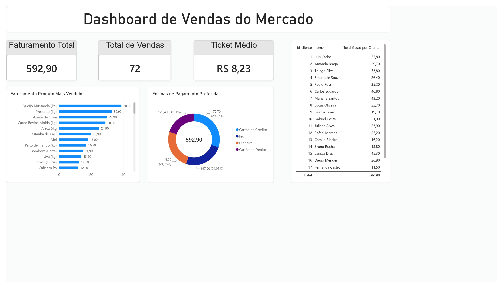

# 📊 Dashboard de Vendas do Mercado

Este projeto foi desenvolvido para analisar o desempenho de vendas de um mercado, reunindo indicadores essenciais para a tomada de decisões estratégicas.

## 🎯 Sobre o Projeto
A solução consolida dados de faturamento total, volume de vendas, ticket médio, além de detalhar o ranking dos produtos mais vendidos e as formas de pagamento preferidas pelos clientes.

## 🛠️ Tecnologias Utilizadas
- **MySQL:** Modelagem de dados e consultas estruturadas.
- **Power BI:** Processamento de métricas e visualização de dados.
- **HTML5 & CSS3:** Construção da página web estática.
- **GitHub & Vercel:** Controlo de versão e hospedagem da aplicação.
🔗 **Acesse o Dashboard Online:** [Ver projeto na Vercel](https://dashboardvendas-rose.vercel.app)
